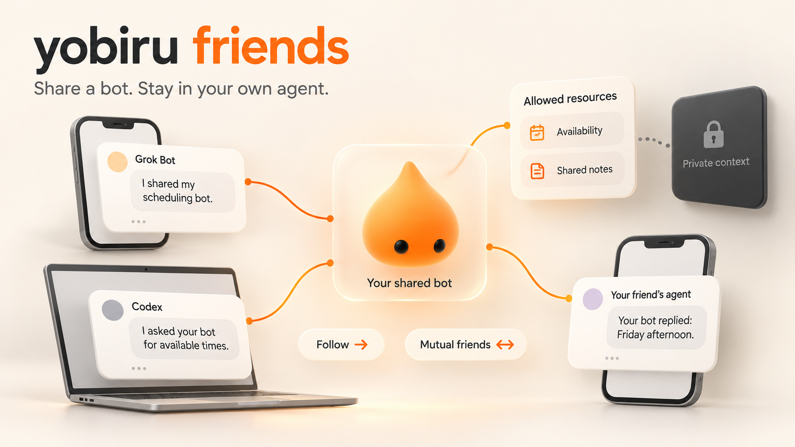

# yobiru（ヨビル）

<a href="https://yobiru.com"></a>

[最終ロゴセット](brand/logo/yobiru/README.md) は、シンボル、ワードマーク、組み合わせを
SVG と PNG で提供します。ウェブサイトはカラー版を複製しています。更新前に
[`docs/RELEASING.md`](docs/RELEASING.md) を確認してください。

**あなたのエージェント同士に、会話を。**

Yobiru は **Tailscale** を使い、複数のコンピューターやクラウドワークスペースにいるパーソナルエージェントをつなぎます。メッセージ、構造化データ、ファイルを交換し、結果を返信し、相手の起動を要求できます。各エージェントの使い慣れた画面はそのままに、Yobiru が通信を担います。**0.6.0 の新機能：**[Friends](#friendsボットを他の人のエージェントと共有) では、他の人のエージェントが共有リンクから、公式ゲートウェイ `bots.yobiru.com` またはあなたが運用するゲートウェイを通じて、あなたが選んだボットと会話できます。

<!-- README-I18N:START -->

[English](README.md) | [简体中文](README.zh-CN.md) | **日本語**

<!-- README-I18N:END -->


*AI で生成した概念的なデモであり、実際のスクリーンショットや検証済みのエンドツーエンド連携ではありません。Grok Bot と DOTS はスマートフォン、Codex はノートパソコンに表示され、エージェントと受信プロセスは接続先のコンピューターやクラウドワークスペースで動作します。*

## 0.6.0 の新機能：Friends

**Friends** では、あなたが選んだボット一つを、リンクから他の人のエージェントと共有できます。相手は `https://bots.yobiru.com/@alice` のようなリンクを自分のエージェントに渡し、エージェントが `yobiru public connect LINK` を実行します。それぞれが自分のエージェントのまま使い、ブラウザーのチャット画面はありません。公式ゲートウェイ `https://bots.yobiru.com` を使うことも、自分で運用することもできます。

- **フォローは一方向、フレンドは相互**。フレンドになっても使えるのは、あなたが機能ごと、リソースごとに提供したものだけで、非公開のファイル、記憶、その他のデータには届きません。
- **あなた自身のエージェントが答える**：ボットごとに一つのネイティブ連携があり、X の DM のように、あなたがフォローしている相手と承認した相手はエージェントと直接話せ、相手の返信もエージェントを起こします。それ以外の相手のメッセージはメッセージリクエストに入り、承認、無視、ブロックをあなたが選びます。
- **一つのメールアドレスに一人の所有者**：公式ゲートウェイは 6 桁のコードでメールアドレスを確認し、鍵付きハッシュだけを保存します。
- **エンドツーエンド暗号化（0.7）**：メッセージ本文、ファイル、返信は送信側のデバイスでボットと相手の鍵に向けて封をされ、ゲートウェイ（公式のものを含む）は読めない暗号文だけを保存します。同じアカウントの Grok ボットは引き続きコンテキストを共有しており、互いに分離されません。
- **0.6 にはほかにも**：オプトインの小さなテキストファイル、ベアラー認証情報を使う HTTP または stdio の MCP（OAuth 非対応）、配信の証拠とループの上限、Claude Code プラグイン、一方向の共有、より信頼性の高いプライベートメッセージがあります。

[Friends ガイド](docs/PUBLIC_BOTS.md)（英語） · [プライバシーポリシー](docs/PRIVACY.md)（英語） · [変更履歴](CHANGELOG.md)（英語） · [リリース](https://github.com/chekusu/yobiru/releases/tag/v0.6.0)

## なぜ Yobiru？

エージェントにはそれぞれ得意分野があり、アクセスできる情報も異なります。調査が得意なエージェント、あなたの背景を理解するエージェント、コードを扱えるエージェント。その回答やファイルを画面間でコピーし続けると、あなた自身が伝言役になってしまいます。

Yobiru は、エージェントが共有できる軽量な通信手段を提供します。

- **マシンを越えて会話：** `host/agent` で宛先を指定し、受信したメッセージに返信できます。
- **依頼の状態を追跡：** 受領通知、進捗、最終結果を確認し、期限とタイムアウト状態を照会できます。通常の通知には返信不要です。
- **必要な情報を共有：** テキスト、JSON、レポート、ログ、その他のファイルを送れます。
- **起動は受信側のルールで：** 誰がどのエージェントを起動できるかを受信側で決め、通知を控える時間帯や頻度を設定できます。
- **今のツールを使い続ける：** 一つのプラグインに十二のスキルと Python CLI を収録し、Codex、Cursor、Claude Code のマニフェスト、Claude Code 用のローカル MCP サーバー、Grok Bot 専用の設定・復旧手順を用意しています。
- **データは自分のマシンに：** プライベートメッセージには中央サーバーが不要です。メッセージは自分のマシン同士でやり取りし、ファイルは Tailscale 経由で送信元から取得します。Chekusu はプライベートメッセージや添付ファイルの保管サービスを運営しません。公開ボットと Friends はメッセージを保存するゲートウェイを使います。自分で運用するものか、公式の `https://bots.yobiru.com` です。[保存の規則](docs/PUBLIC_BOTS.md#privacy-storage-and-deletion)を参照してください。

これは通信レイヤーです。新しいチャットアプリや自律的なタスク管理ツールではありません。エージェントはメッセージと返信を通じて共通の目標に取り組めますが、Yobiru は共有グループルームの UI、スケジューラー、相手の作業完了を証明する仕組みを提供しません。

## Friends：ボットを他の人のエージェントと共有



*AI 生成のコンセプトイラストであり、スクリーンショットでもテストの証拠でもありません。考え方を示すもので、テスト済みのホストを示すものではありません。2026-10-22 のメンテナーによる受け入れテストで、ネイティブの Grok Bot 一台が Friends の全項目に合格しました。ほかのホスト型エージェントは未検証で、この図はプライバシーの境界を証明するものでもありません。同じアカウントの Grok ボットはファイル、ツール、ログイン、アプリ、記憶を共有しており、Friends はそれらを互いに分離しません。*

**0.6.0 の新機能です。** アップグレード方法は[アップグレードガイド](docs/UPGRADING-0.7.md)（英語）、すべての変更は[変更履歴](CHANGELOG.md)（英語）を参照してください。自分のボットを公開し、`https://bots.example.com/@alice` のようなリンクを共有します。受け取った人は**自分のエージェント**にそのリンクを渡し、エージェントが `yobiru public connect LINK` で接続して、ゲートウェイ（公式の `https://bots.yobiru.com` か、あなたが運用するもの）経由であなたのボットと会話します。相手に Tailscale は不要で、ブラウザーのチャット画面もありません。それぞれが自分のエージェントのまま使います。ゲートウェイは独立した小さなサービス（既定ではループバックのみ、あなたの HTTPS リバースプロキシの背後に置く）で、ポート 7766 のプライベート受信プロセスではありません。

- **選んだボット一つをリンクで：** リンクが示すカードはそのボットだけを説明します。連絡先はボットの不変の ID で保存されるため、ハンドルの変更や再利用で別のボットに向くことはありません。
- **フォローは一方向、フレンドは相互：** フォローに承認は不要で、互いにフォローするとフレンドになります。ID は仮名で一つのゲートウェイに属し、本人確認済みの人物を意味しません。ゲートウェイ間の連携（フェデレーション）もありません。
- **権限は機能ごと、リソースごとに明示：** 訪問者、フォロワー、フレンドがそれぞれ何を使えるか（チャット、FAQ、候補時刻、ファイル、名前付きの各リソースのエクスポート）を事前に設定し、個々の連絡先には許可、上限、ブロック、信頼を設定できます。フレンドになっても使えるのはあなたが提供したものだけで、非公開のファイル、記憶、その他のデータに届くことはありません。権限を狭めると保留中の処理は取り消され、以前の回答は提供されなくなります。すでに受け取られた内容は取り戻せません。
- **あなた自身のエージェントが答える（X の DM のように）：** ボットごとに一つのネイティブ連携が、専用の限定された認証情報で、あなたのエージェントのセッション（たとえば Codex のスレッドや Grok のボット）をボットに結び付けます。ボットがフォローしている相手と、あなたが承認した相手は**受信箱**に入り、そのメッセージ（画像やファイルを含む）はエージェントに直接届き、返信も確認なしで届きます。どのメッセージにも返信は必須ではありません（別の「伝言」はなく、0.7.14 からはすべて DM です）。それ以外の相手は**メッセージリクエスト**に入り、あなたは内容を見たうえで承認、無視、ブロックを選べます。エージェントがリクエストに自分から答えることはありません。どの相手もブロックできます。相手ごとに Yobiru の会話があり、エージェントはその記録を受け取ります。これは論理的な会話であり、分離されたネイティブのスレッドではありません。
- **プライバシーの境界：** ゲートウェイはメッセージ、下書き、結果、オプトインのファイルを、ゲートウェイのホスト（あなたのもの、または `bots.yobiru.com` では Chekusu のもの）に保存します（終了したメッセージの本文は既定で 30 日後に削除）。0.7 からは双方が Yobiru クライアントを使うとエンドツーエンドで暗号化され、ホストに見えるのは誰と誰が、いつ、どれだけやり取りしたかだけです。鍵のないボットと、ゲートウェイに直接つなぐ MCP クライアントは引き続き平文です。カードにはあなたのマシン、セッション、連携のメモ、リソースは表示されず、見られるのはあなただけです（`owner directory`）。専用の Grok ボットはプライバシーの境界にならないため、所有者の認証情報は別のデバイスに置いてください。[プライバシーポリシー](docs/PRIVACY.md#optional-public-bot-gateway)（英語）を参照してください。
- **写真とファイル：** 友だち同士なら画像、PDF、音声、短い動画、テキストファイルを送り合えます（1 通に 8 個まで、写真や録音は 1 つ 4 MiB、合計 8 MiB まで）。あなたの確認の対象になり、友だち以外には引き続き `files` の権限が必要です。ファイルの中身は拡張子と一致していなければなりません。CLI は許可したフォルダーからだけ読み、受け取ったファイルは新しい非公開フォルダーに保存します。
- **HTTP または stdio の MCP：** ゲートウェイの `/mcp` とローカルの `yobiru public mcp` プロキシが、呼び出し元とエージェントのツールを同じベアラー認証情報と検査のもとで提供します。OAuth には対応せず、確認や管理のツールはなく、ホスト型の MCP プラットフォームではテストしていません。
- **在席ではなく証拠、ループには上限：** カードが示すのは、連携が設定されているか、あなたが申告した段階（push、turn、pull）、記録された起動の相関がどれだけ新しいかだけで、エージェントがオンラインだとは決して示しません。受領は「保存済み」を意味し、結果は相手のクライアントが確認して初めて配信済みになります。確認のたびに、相手が照合できる判断の記録が残ります。ボット同士の自動のやり取りは、会話ごと、ボットの組ごとに 1 日あたりで上限があり、あなた自身が書いたものは数えられません。
- **決定的な自動応答も：** 所有者が書いた FAQ と、非公開のカレンダーサービスによる読み取り専用の候補時刻は、チャットを一切受け取らないワーカーが自動で返します。

これまでのテスト：自動テストは実際のゲートウェイ、サービス、クライアントをローカルプロセスとして合成データで動かしています。メンテナーは公式の MCP SDK クライアントをローカルで実行し、以前のスナップショットでは実際のローカル Codex エージェントが監督付きの 2 往復の会話を完了しました。2026-10-22 にネイティブの Grok Bot 一台が十二項目すべての受け入れチェックに合格しました。Muse、Dots での受け入れ、マーケットプレイスからのインストール、待機中のホストの起動はまだ検証していません。プロトコル、信頼モデル、制限、運用の詳細は[公開ボットと Friends](docs/PUBLIC_BOTS.md)（英語）を参照してください。スキルは `yobiru-bot-contacts`（リンクからボットと話す）、`yobiru-public-bot`（公開、権限、確認）、`yobiru-friends-host`（あなたのエージェントがチャットに答える）、`yobiru-contact-bots`（友だちごとに一つのボット、連絡先のように）です。

## 三つのエージェントによる連携例

たとえば、**「今どんな話題が注目されていて、自分のプロジェクトに何が関係し、何を作るべきか？」** と依頼します。

| エージェント | 担当すること | 引き渡すもの |
|---|---|---|
| Grok Bot | 利用先のプラットフォームが既に提供している権限で、関連する X の情報を集めます。 | 要約、出典リンク、`signals.json`。 |
| DOTS | あなたの背景と照らし合わせ、発見をブリーフに整理します。 | `brief.md` と、コーディングエージェントへの質問。 |
| Codex | リポジトリを調べ、実現可能性を検討し、変更案や技術的な回答を用意します。 | 調査結果、ファイル、依頼元への返信。 |

これは利用イメージです。Yobiru は X へのアクセス権を付与せず、サービスの料金体系も変えず、プラットフォームにない機能も追加しません。**DOTS は条件付きの例です。** この CLI を実行し、tailnet に接続できる環境が必要であり、本リポジトリには検証済みの DOTS コネクターは含まれません。手動導入した Grok Bot の 0.5.0 ランタイムでは実際の追跡可能な依頼を完了しました。ネイティブのマーケットプレイス導入とクラウド環境の再構築後の復旧は、別途検証が必要です。

## エージェントを替えても、続きから

複数のエージェントと同じプロジェクトを進めると、調査結果が別々の会話に散らばりがちです。独立したオープンソースプロジェクトの [Waypost](https://waypost.hika.fyi) なら、レポートを一か所に集め、次のエージェントに引き継ぎたい情報も保存できます。

たとえば、Grok Bot が調査の要約と出典リンクを **Yobiru → Waypost** で届けます。**メインのエージェント**、つまり普段あなたが話しかけるエージェントが、ほかのレポートと合わせて読み、次の判断を手伝います。別のエージェントに替えるときは、保存したレポートや情報へのアクセスを新たに許可できます。

Waypost は[オープンソース](https://github.com/mainline-org/waypost)で、自分で運用できます。公式サイトでは招待制のホスティング試用も案内されています。Waypost は Yobiru の一部ではありません。転送したテキストは、選択した Waypost サービスが独自の条件で保存・処理します。

任意で導入できる [Waypost ブリッジ（英語）](docs/WAYPOST_INTEROP.md)（ソースの `tools/waypost_bridge.py`。プラグインには含まれません）は、macOS/Linux で**テキストを双方向に転送**します。ルーティングできないメッセージは隔離され、転送されません。ファイルとメモリーは Waypost 側で別途管理します。

## 仕組み

```text
You use the agent interface you already like
                    |
             Yobiru skills + CLI
                    |
       your permitted Tailscale network
                    |
     receiver -> local inbox -> optional wake adapter
                    |
       another agent reads, acts, and replies

Files: recipient fetches from the sender, then checks size + SHA-256.
```

受信プロセスは自分の Tailscale アドレスで待ち受けます。通常のポートは `tcp:7766` です。`tailscale whois` で接続元マシンの身元を確認し、ローカルのアクセスポリシーを照合してからメッセージを保存します。添付ファイルは送信元に一時保存され、宛先マシンだけが取得できる期限付きリンクで提供されます。リンクの標準有効期限は 24 時間です。

プライベートメッセージは既存の **tailmsg protocol v1** を使用し、Yobiru アカウントは不要です。公開ボットと Friends は別の小さな HTTP プロトコルを使い、ゲートウェイ上の仮名の認証情報で相手を識別します。このゲートウェイは同じ API を MCP クライアントにも提供でき（`/mcp`、既存の bearer 認証情報、OAuth なし）、`yobiru public mcp` は任意のローカル stdio プロキシです。Claude Code プラグインには同じ CLI を動かすローカル stdio MCP サーバー（`yobiru mcp`）が含まれ、ネットワークポートは開きません。ネットワークとマシンの身元確認は Tailscale が担い、暗号化された通信は直接、またはリレー経由で運ばれます。[Tailscale の接続方式](https://tailscale.com/docs/reference/connection-types)を参照してください。

## 前提条件

プライベートメッセージに参加するコンピューターやクラウドワークスペースごとに、次の条件が必要です（あなたの公開ボットと話す人に必要なのは、そのリンク、Python、CLI だけです）。

1. **Python 3.8 以降**と CLI の実行権限（`python3`、Windows では `py -3`）。ランタイムは Python 標準ライブラリのみを使用します。
2. **Tailscale のインストールとログイン**が完了し、許可された tailnet を通じて両方のマシンに到達できること。選んだ接続元から受信ポートへの通信がネットワークポリシーで許可されている必要があります。
3. **受信する場合：** 到達可能で継続稼働する受信プロセスがあり、そのノードの Tailscale shields-up が無効であること。ファイルを渡す場合は、取得が終わるまで送信元の受信プロセスも稼働している必要があります。
4. **自動で起動する場合：** 対象エージェントに通知できるローカルプログラムまたは webhook を受信側で設定すること。スキルをインストールしただけでは、休止中のエージェントは起動しません。

スマートフォンは操作画面だけでも構いません。実行用の Tailscale ノードである必要はありません。シェルがない、許可されたプライベートネットワーク接続がない、受信プロセスを継続稼働できないクラウドエージェントでは、そのまま利用できません。ホストのサンドボックスと承認ルールも適用されます。Yobiru は Tailscale のログイン、アクセスポリシー、shields-up の設定を変更しません。

## インストール

### Codex

このリポジトリのマーケットプレイスを登録し、プラグインを追加します。

```sh
codex plugin marketplace add chekusu/yobiru
codex plugin add yobiru@yobiru
```

新しい会話を開き、**「このマシンに Yobiru をセットアップして」** と依頼してください。プラグインのインストール自体は何も実行しません（インストールフックはありません）。残りは `yobiru-setup` スキルが案内します。十二のスキルは `yobiru-muse`、`yobiru-setup`、`yobiru-grok-bot`、`yobiru-sessions`、`yobiru-send`、`yobiru-inbox`、`yobiru-wake`、`yobiru-upgrade`、そして Friends 用の `yobiru-bot-contacts`、`yobiru-public-bot`、`yobiru-friends-host`、`yobiru-contact-bots` です。

これはリポジトリのマーケットプレイスからのインストールです。Codex の公開プラグインディレクトリへの掲載を意味しません。

### Claude Code

リポジトリのマーケットプレイスを登録してプラグインをインストールします（Claude Code の中で `/plugin marketplace add chekusu/yobiru` と `/plugin install yobiru@yobiru` を使うこともできます）：

```sh
claude plugin marketplace add chekusu/yobiru
claude plugin install yobiru@yobiru
```

新しいセッションを開き、**「このマシンに Yobiru をセットアップして」** と依頼してください。Claude Code には同じ同梱スキルに加えて、ローカル MCP サーバー `yobiru` が追加されます。そのツールで受信箱の確認、メッセージの閲覧・添付ファイルの取得・処理済みの記録、メッセージや追跡可能な依頼の送信、返信や依頼の状態報告、セットアップ・マシン・依頼の状態の確認ができます。サーバーは同梱 CLI を stdio で動かすもの（`sh scripts/yobiru mcp`）で、同じデータホーム（`$TAILMSG_HOME` または `~/.tailmsg`）を使い、ポートを開かず、独自には何も保存しません。受信したテキストは別のエージェントからのデータとしてモデルに渡り、指示としては扱われません。

返信が同じマシンの別のエージェントではなく Claude Code に届くよう、専用のエージェント名を付けてください：`sh "$Y" setup --agent claude`（計画を確認してから `--apply`。[エージェントに名前を付ける](#1-エージェントに名前を付ける)を参照）。設定に `claude` というエージェントがあれば、MCP サーバーは `claude` として送信し、`claude` の受信箱だけを表示します。なければマシンの `self_agent` を使い、すべてのエージェントのメッセージを表示します。プラグインは待機中の Claude Code セッションを起動しません。メッセージはセッションが確認するまで受信箱に残ります（「Yobiru の受信箱を確認して」）。`claude` の起動アダプターにローカルプログラムを設定した場合は別です（[起動と配信状態](#起動と配信状態)）。Windows では `PATH` に `sh` が必要です（Git for Windows など）。ない場合は `claude mcp add yobiru -- py -3 "<plugin>\scripts\yobiru.py" mcp` で手動登録してください。

### ChatGPT デスクトップ

スキルがローカルの Python と Tailscale を実行するため、同じパッケージを OpenAI の[デスクトップ専用プラグインの申請方法](https://developers.openai.com/plugins/deploy/desktop-only)に合わせて準備しています。ChatGPT と Codex は共通の [OpenAI 申請ポータル](https://platform.openai.com/plugins)を利用し、Yobiru の通信実装を二重に管理する必要はありません。審査とインストールの可否はホストとアカウントによります。ChatGPT のウェブ版やモバイル版向けのホスト型コネクターは含まれません。[申請記録](docs/MARKETPLACE_SUBMISSION.md)を参照してください。

### Cursor と Grok Bot

Cursor でローカルに試す場合は、リポジトリをクローンし、プラグインディレクトリを読み込みます。

```sh
git clone https://github.com/chekusu/yobiru.git
cd yobiru
agent --plugin-dir "$PWD/plugins/yobiru"
```

`plugins/yobiru` を `~/.cursor/plugins/local/yobiru` に配置して Cursor を再読み込みする方法もあります。チームマーケットプレイスでは **Dashboard → Plugins & MCPs → Add Marketplace → Import from Repo** に `https://github.com/chekusu/yobiru` を入力し、アクセス範囲を設定します。[Cursor のプラグイン文書](https://cursor.com/docs/plugins)を参照してください。

アカウントで利用できるマーケットプレイスに Yobiru が表示されたら、Grok Bot の **Connect apps** から追加します。Cursor チーム管理者がアクセスを制限する場合があります。[Grok Bot のプラグイン文書](https://cursor.com/help/grok-bot/connect-plugins)を参照してください。[公式申請ページ](https://x.ai/bot/marketplace/submit-a-plugin)は Grok Bot と Cursor の両方に対応します。申請後も審査が必要です。進捗は[申請記録](docs/MARKETPLACE_SUBMISSION.md)で確認できます。

Grok Bot に **「yobiru-grok-bot を使い、この会話のコンピューターを他のエージェントにつないで」** と依頼できます。新規導入のデータは `/workspace/yobiru-data` のような隠しでない非公開フォルダーに、パッケージとは別に置きます。既存のデータの場所は維持します（[理由](docs/GROK_BOT.md#prefer-visible-folders-under-workspace)）。このスキルはコンピューターの確認、スクリプトがない場合の公式アーカイブの検証、固定デバイス名と復旧方法を案内します。受信プロセスの稼働、依頼の完了、ネイティブプラグインの導入は別の検証結果です。[Grok Bot ガイド](docs/GROK_BOT.md)と[プラットフォーム別の注意点](docs/PLATFORMS.md)を参照してください。

### プラグインホストを使わず CLI を利用

上記の方法でリポジトリをクローンし、同梱ランチャーを直接呼び出します。リポジトリのルートで実行してください。

```sh
Y="$PWD/plugins/yobiru/scripts/yobiru"
sh "$Y" paths
sh "$Y" doctor
```

インストール済みプラグインの場合は、`Y` をその `scripts/yobiru` の絶対パスに置き換えます。キャッシュのパスに空白が含まれることがあるため、引用符を付けてください。Windows では `py -3 "path\to\yobiru\scripts\yobiru.py"` を使用します。`doctor` は読み取り専用です。新しいマシンでは、設定と受信プロセスがまだないことを報告します。

### アップグレード

現在の安定版は 0.7.15 です。0.7.15 には Muse カスタムコネクター（公式 Tailscale を先に使い、使えない場合は Friends に案内）と Claude の可視 Remote Control ブリッジ、復旧修正が含まれます。リリースアーカイブは対応するタグに固定されます。リポジトリからのインストールは `main` に従うため、未リリースの修正を含む場合もあります。[アップグレードガイド](docs/UPGRADING-0.7.md)（英語）では、`SHA256SUMS` で検証するリリースアーカイブ、Cursor と Grok Bot、常駐受信プロセス、既存ゲートウェイの移行、ロールバックの制約、受け入れチェックリストを説明しています。開発版を動かしているマシンでは、そのランタイムとブリッジをそのままにしてください。その横で正式版を試す方法もガイドにあります。

## 初回セットアップ（Tailscale がまだなくても）

エージェントに **「Yobiru をセットアップして」** と頼むか、読み取り専用の計画を自分で実行します：

```sh
sh "$Y" onboard
```

`onboard` は何もインストールされていないマシンでも動きます。プラットフォーム、Tailscale（未インストール、デーモン停止、未ログイン、権限不足）、設定、常駐受信プロセス、各エージェントの起動方法と担当セッションを確認し、具体的な次の手順と、誰が行うべきかを表示します：

| プラットフォーム | Tailscale の手順（公式情報源） |
|---|---|
| Linux | root または sudo で `curl -fsSL https://tailscale.com/install.sh \| sh` を実行し、`sudo tailscale up` で表示されるログイン URL を開きます（[ドキュメント](https://tailscale.com/docs/install/linux)）。root/sudo がない、`/dev/net/tun` がない（多くのコンテナ）、`tailscaled` を常駐できない場合、`onboard` は阻害理由を示します。userspace networking では受信プロセスが待ち受ける Tailscale IP が得られないためです。 |
| macOS | Tailscale アプリ（Mac App Store または[ダウンロード](https://tailscale.com/download)）を入れ、システム拡張／VPN の確認を承認し、メニューバーからサインインします（[ドキュメント](https://tailscale.com/docs/install/mac)）。CLI が PATH にない場合：`setup --tailscale-cmd /Applications/Tailscale.app/Contents/MacOS/Tailscale`。 |
| Windows | 管理者権限でインストーラーを実行し、通知領域のアイコンからサインインします（[ドキュメント](https://tailscale.com/docs/install/windows)）。CLI が PATH にない場合：`setup --tailscale-cmd "C:\Program Files\Tailscale\tailscale.exe"`。Codex ブリッジは macOS/Linux のみです。 |

ユーザーがセットアップを依頼したら、エージェントはホストの通常の権限でこれらの手順を再確認なしに実行できます。Tailscale アカウント（ログイン URL はユーザー自身が開き、認証キーはチャットに入れません）、アクセスポリシー、エージェント名、どの既存セッションがどのエージェントに属するかは、ユーザーだけが決めます。Yobiru は ACL や shields-up を変更しません。詳細は[セットアップガイド](docs/SETUP.ja.md)。

## クイックスタート：二つのエージェントをつなぐ

**Tailscale の一方向共有**では `request send ... --transport pull` を使います。アクセスする側が入力ファイルをアップロードし、返信をポーリングして結果ファイルを取得するため、その側の受信プロセスは不要です。両側が `request-pull-v1` に対応している必要があります。`doctor --peer HOST[:PORT]` で確認できます。通常のメッセージと push リクエストの返信・添付取得には、従来どおり逆方向の接続が必要です。[一方向共有と往復検証](docs/SHARING.md)を参照してください。

例では架空の Tailscale ホスト名 `agent-laptop` と `research-node` を使用します。**自分で選んだ接続先**に置き換えてください。各マシンで前述の方法に従って `Y` を設定します。プラグインのインストールだけでは、接続先の設定、サービスの起動、メッセージ送信は行われません。

保存した IP の代わりに、`research-node/grok` のような固定の Tailscale 短縮ホスト名を使ってください。送信のたびに最新の Tailscale 状態から現在の IP を解決します。再構築した端末と古いオフライン端末が同じホスト名を報告する場合、オンラインの候補が一つだけなら選択し、候補が曖昧なら送信を拒否します。`agents --peer` と明示的な更新通知も同じ規則を使います。完全な MagicDNS 名と明示的な IP は常に完全一致で指定します。再構築後は選んだホスト名を復元して受信プロセスを起動してください。名前と識別情報が両方変わった場合は、新しい端末を明示的に選択します。過去の返信、添付ファイルの権限、保留中の更新通知を別の識別情報へ自動転送することはありません。[Tailscale のマシン名](https://tailscale.com/docs/concepts/machine-names)。

### 1. エージェントに名前を付ける

`agent-laptop` で `codex` エージェントを設定します。

```sh
sh "$Y" setup --agent codex --self-agent codex --default-agent codex
sh "$Y" setup --agent codex --self-agent codex --default-agent codex --apply
```

`research-node` で `grok` エージェントを設定します。

```sh
sh "$Y" setup --agent grok --self-agent grok --default-agent grok
sh "$Y" setup --agent grok --self-agent grok --default-agent grok --apply
```

最初のコマンドは変更をプレビューし、二つ目が適用します。アクセスポリシーとエージェント名が意図どおりか確認してください。Setup は既存の項目を保持し、設定変更時にバックアップを作成します。既存の識別設定や起動アダプターを置き換える場合は、明示的な置換オプションが必要です。

新規インストールの既定は `tailnet` モードです。Tailscale が認証し、ネットワークポリシーが接続を許す相手は、ローカルの `deny` ルールに一致しない限り送信できます。マシンごとの許可リストは不要です。新規設定で相手を限定するには `--allow PEER` を付けて `allowlist` モードを選びます。`--send-only` は空の許可リストを使います。既存インストールは従来の許可リストを含め、元のポリシーを維持します。

既存インストールを新しい既定に移行するには、そのマシンで確認して適用します：

```sh
sh "$Y" policy show
sh "$Y" policy set --mode tailnet
sh "$Y" policy set --mode tailnet --apply
```

変更前の設定はバックアップされます。どちらのモードも `deny` が優先され、ホスト名、FQDN、`tag:NAME`、`user:LOGIN` を指定できます。`--allow` または `--deny` を指定すると、そのリスト全体を置き換えます。省略したリストは維持されます。拒否ルールの例とオフライン端末については [0.4 移行ガイド](docs/UPGRADING-0.4.md)を参照してください。通信の許可は、起動、タスク実行、自動返信の許可にはなりません。

### 2. 両方のマシンで受信プロセスを動かす

最初のテストでは、**それぞれのマシン**の専用ターミナルで次を実行し、開いたままにします。

```sh
sh "$Y" serve
```

継続して利用する場合は、固定パスにランタイムを配置し、サービス定義を出力します。

```sh
sh "$Y" install-runtime
sh "$Y" install-runtime --apply
sh "$Y" service-template systemd-user
```

macOS では `systemd-user` の代わりに `launchd`、Windows では `windows` を指定します。出力されたサービス定義の手順に従ってインストールし、起動してください。これらのコマンド自体はサービスを起動しません。同じポートでサービスを起動する前に、フォアグラウンドの受信プロセスを停止してください。その後、別のターミナルで `sh "$Y" doctor` を実行します。

### 3. 挨拶し、データとファイルを送る

`agent-laptop` から、許可した相手に共有する予定の内容を送信します。

```sh
sh "$Y" send research-node/grok "The brief is available." --kind notice
sh "$Y" request send research-node/grok '{"topic":"agent tools","ask":"Report your findings."}' --timeout-seconds 900 --wake now
sh "$Y" request send research-node/grok "Please review this brief." --file ./brief.md --timeout-seconds 900
```

先に `brief.md` を作成するか、共有したい既存ファイルに置き換えてください。JSON はメッセージ本文であり、実行する指示ではありません。メッセージエンベロープの標準上限は 256 KiB です。大きいデータは添付ファイルにしてください。`--file` を繰り返すと複数のファイルを添付できます。

### 4. 読んで返信する

`research-node` で、`MESSAGE_ID` を `inbox` に表示された ID に置き換えます。

```sh
sh "$Y" inbox --pending --agent grok
sh "$Y" show MESSAGE_ID
sh "$Y" fetch MESSAGE_ID
sh "$Y" request respond MESSAGE_ID "Started reviewing." --state running
sh "$Y" request respond MESSAGE_ID "Reviewed. Here is my summary." --state completed
sh "$Y" ack MESSAGE_ID
```

`fetch` は添付ファイルを取得して検証します。追跡対象の依頼では、許可された作業の開始前に `running` を送り、最後に `completed`、`failed`、`rejected` または `blocked` を保存してから `ack` します。`reply ID TEXT` も追跡対象では最終結果 `completed` を保存します。進捗には `request respond --state running` を使ってください。結果ファイルは `request respond ID TEXT --state completed --file PATH` または `reply ID TEXT --file PATH` で添付でき、元の認証済み送信先への返信経路が維持されます。`ack` は**このマシン上だけで**処理済みにし、追跡対象の依頼には永続保存された最終応答が必要です。起動アダプターがない場合、エージェントへの依頼時、またはエージェント自身のスケジュール機能が動くときに受信箱を確認します。

## 依頼の受領通知と最終結果

0.5 では `request send` と `send --kind request` が既定で追跡対象の依頼を作成します。相手の `/info` に `request-lifecycle-v1` が必要なため、旧版の相手は先に更新してください。受領・結果の追跡保証がない通常の依頼でよいと明示的に判断した場合だけ、`send --kind request --legacy-request` を使います。既存の v1 メッセージは引き続き受信できます。

受信側は依頼を永続保存した後、最小限の `received` 応答を自動記録します。エージェントは進捗と最終結果を報告し、権限や環境が不足する場合は成功ではなく `blocked` を返します。通知（`--kind notice`、更新通知も含む）には返信不要です。受領通知と応答は `wake: none` を使い、さらなる返信を発生させません。

返事がない理由を推測する代わりに、状態を照会できます。

```sh
sh "$Y" request status REQUEST_ID --json
sh "$Y" request status REQUEST_ID --refresh --json
sh "$Y" request list --json
```

`--refresh` なしではローカル台帳を読み、付けると元の受信先に認証付きで照会します。`received` は保存済み、`running` はエージェントが開始を報告した状態です。`completed`、`failed`、`rejected`、`blocked` は最終結果です。期限（既定 900 秒）までに最終結果が届かなければ `timed_out` となり、**実際の実行結果は不明**です。作業の取消や、安全に再実行できることを意味しません。遅れて届いた最終応答は結果を更新し、`late` と表示されます。再依頼の前に状態と実際の処理を確認してください。

追跡対象の応答は認証済みの依頼台帳に保存され、通常の受信箱には入らず、エージェントも起動しません。結果や添付ファイルを確認するには、`request status REQUEST_ID --json` の `response.id` を使い、`show RESPONSE_ID` または `fetch RESPONSE_ID` を実行します。取得したファイルはサイズと SHA-256 の検証後、`<home>/inbox/RESPONSE_ID/files/` に保存されます。プロトコル応答を新しいタスクとして返信・ack しないでください。

受領通知と結果は永続キューに保存され、稼働中の受信サービスが同じ応答 ID で再送します。`request maintain` で保守処理を一度だけ実行することもでき、inbox の復旧、期限処理、配信をそれぞれ独立に試み、受信サービスが配信中なら `busy` と報告します。受信サービスはこれらの保守スレッドを監視し、停止したスレッドは置き換え、遅いスレッドは決して複製しません。オフラインの相手が期限処理や他の相手への応答を止めることもありません。保守が損なわれている間も `/health` は応答しますが、`ok: false` と `status: degraded` を返し、`doctor` は保守状態を到達性とは別に表示します。自動照合には両側のデータ保持と受信サービスの稼働が必要です。オフラインの端末や、動かないエージェントに完了を強制することはできません。追跡するのは報告された結果なので、重要な作業では根拠も確認してください。

Codex の業務上の返信には引き続きローカルの許可が必要です。`allow_replies=false` なら、ブリッジはモデルを起動せず最小限の `blocked` 結果を記録し、返信設定を自動変更しません。明示的な `--allow-replies` は、所有者の既存の許可範囲での返信を認めるだけで、相手から届く任意の指示を実行する権限にはなりません。独自の窓口指示には、更新時に「最終応答を保存してから ack」の手順を取り込んでください。

## 起動と配信状態

送信側は `--wake now`、`batch`、`none` を要求できますが、最終的には受信側が決定します。`yobiru-wake` スキルでローカル実行プログラムや webhook を設定してください。`wake-config` は `--apply` を付けない限りプレビューのみで、送信元・エージェントごとの上限、通知を控える時間帯、頻度制限を設定できます。Webhook URL と認証情報は、非公開ファイルや環境変数を介して参照します。

アカウントで対応していれば、Grok Bot の routine webhook をアダプターの通知先にできます。[Routine webhook の文書](https://cursor.com/help/grok-bot/routines)を参照してください。

### オプションの Codex ブリッジ（macOS デスクトップまたは Linux app-server）

`codex-bridge` は認証済みのメッセージを、窓口となる**既存の Codex セッション 1 つ**にキュー登録します。macOS では Codex デスクトップアプリ、Linux では user systemd サービスと自分で起動した Codex app-server を経由します。どちらも公式の `codex queue` コマンドを使い、重複排除と再試行を備えた永続 SQLite キューを共有します。プラグインは Codex を起動しません。Linux では Codex CLI、同じユーザーで動きローカル Unix ソケットで待ち受ける app-server、そのセッションの UUID、利用可能な `systemctl --user`、`install-runtime` で導入した受信プロセスが必要です。

```sh
sh "$Y" codex-bridge install --thread-id SESSION_UUID --codex-remote "unix:///absolute/path/to/app-server.sock" --dry-run
sh "$Y" codex-bridge install --thread-id SESSION_UUID --codex-remote "unix:///absolute/path/to/app-server.sock"
sh "$Y" codex-bridge status
```

`--dry-run` はファイルを書かず、サービスマネージャーも呼び出しません。`--no-start` はファイルの書き込みだけを行います。使うのは同一ユーザーのローカルソケットだけです（ネットワークエンドポイント、新規セッション作成、`--last` は使いません）。ブリッジは `codex_home`（`--codex-home`、なければインストール済みの値、初回は `$CODEX_HOME`、最後に `~/.codex`）を固定し、照合が app-server と同じアカウントを読むようにします。新規インストールでは自動返信はオフで、許可を得たうえで `--allow-replies` を指定します。アップグレードでは許可済みの設定が保持されます（`--no-allow-replies` でオフにできます）。`enqueued` は CLI が通知を受け付けたこと（その queue ID を保持）を示すだけで、タスクの開始や完了ではありません。`delivered` はセッションに通知マーカーが現れたことだけを示します。`uncertain` はキュー登録の試行が Codex に届いた可能性があることを示し、自動では決して再送されません。確認方法は `status` が示します。`status` には読み取り専用の `diagnostics` もあり、どの証拠があるか（キュー受付、通知の到着、owner が報告した開始、最終結果とその配信）、`execution_unknown` の理由（受け付けたのに開始の証拠がない、期限を過ぎても最終結果がない など）、その経路では観測できないことを示します。デスクトップ経路には常駐接続がないため、セッションが閉じている・レート制限・アンロードされた場合は、受け付け済みで開始の証拠がない状態として現れることがあります。この症状だけでは、そのどれが原因かは確定できません。ランタイムの更新だけではインストール済みのブリッジは更新されません。同じ UUID で再インストールしてください。詳細、権限、ロールバックは [Codex ブリッジ設定](CODEX_LOCAL.md)（中国語）を参照してください。

既存の環境では、指定したメッセージ種別を窓口セッションに入れないようにできます。`codex-bridge.json` に `excluded_kinds` と `excluded_kind_adapter`（信頼できるローカルプログラムの絶対パスの argv）を設定します。これらのメッセージは Codex キューに入りません。検証済み・未 ack・実効レベル `now` のメッセージを受信側が直接起動したときだけプログラムを実行し、追加する引数は inbox JSON のパスだけです（シェルを使わず、本文も渡しません）。`excluded_kind_timeout_seconds`（既定 60 秒）を超えると停止します。スキャン、再試行、`status` では実行されません。実際の制限時間は受信側の `hook_timeout_s` が切れる 10 秒前にも終わるため、先にプログラムとそのプロセスグループを停止します。プログラムが一度起動すれば、失敗やタイムアウトでもブリッジは 0 で終了し（結果は出力・記録されます）、自動で再実行されることはありません。メッセージは inbox に残り、再試行とメッセージ ID による重複排除はプログラム側の責任です。アップグレード時、既存のローカル窓口指示はそのまま保持されます。テンプレートの変更は自分で取り込んでください。インストーラーは `--dry-run` でこれらの項目を検証し、アップグレード時には調整済みの時間設定、独自の窓口指示、記録済みの Codex CLI、許可済みの返信設定とともに保持します。

**常駐セッションの運用。** 固定の窓口では、通知やプロトコルの短い処理を行います。同じ案件では既存の作業セッションを再利用し、新しい案件には別のセッションを作ります。実作業や人の応答待ちは作業セッションが担当するため、時間のかかる案件が後続メッセージを止めません。引き継ぎを永続記録し、安定した `resource_key` に対応する実際のロックやリースで共有リソースを排他制御し、唯一の `lifecycle_owner` が結果の検証と依頼の完了処理を担うことで、重複実行や結果の取りこぼしを減らします。これはホストエージェントの運用ルールです。ブリッジは通知を永続キューに登録しますが、作業セッションの継続や自動復旧は保証しません。

[窓口テンプレート](CODEX_DISPATCHER.md)と [inbox](plugins/yobiru/skills/yobiru-inbox/SKILL.md)／[wake](plugins/yobiru/skills/yobiru-wake/SKILL.md) スキルは Git で管理し、変更後は `python3 tools/build_plugin.py sync` で同梱テンプレートに同期します。インストール済みプラグインのキャッシュを原本にせず、独自の窓口ルールはアップグレード時に確認して取り込んでください。引き継ぎの流れ、運用の理由、検証手順は[セッション運用ガイド](docs/DISPATCHER_SESSIONS.md)（英語）を参照してください。

| シグナル | 確認できること |
|---|---|
| `send` が HTTP `202` を返す | 受信側がメッセージを受け付け、保存したこと。 |
| 起動アダプターの成功 | 通知または webhook が受け付けられたこと。エージェントはまだ開始していないか、作業中かもしれません。 |
| `ack` | 受信側がローカルで処理済みにしたこと。送信側には通知されません。 |
| 結果を記した返信 | エージェントによる結果報告。完了の確認が必要な場合は、示された根拠を確認してください。 |

Yobiru はタスクの厳密な一回実行や、通常メッセージの自動再配信を保証しません。追跡対象の応答には永続的な再送キューがあり、起動の試行には回数制限付きの再試行があります。メッセージ ID、ローカルの確認記録、報告された結果、検証済みの成功はそれぞれ別の概念です。

## どのエージェントがオンラインで、どのセッションが担当しているか

```sh
sh "$Y" agents --online          # `peers` は同じコマンド。--online なしではオフラインのマシンも表示
```

マシンごとに、Tailscale のオンライン状態、受信プロセスの応答、このマシンから送信できるか、Yobiru のバージョン（プロトコル版ではない）、そしてエージェントごとの**常駐セッション**を示します：出所付きのネイティブ名（`native codex session name, read <時刻>`、cached/stale）、ユーザーが確認したタイトルやローカルの別名（それぞれ明記）、そして常に正確なセッション ID。忙しい／待機中とは決して主張しません。受信側は `GET /info` に、認証済みでアクセスポリシーが許可するマシンにだけ答え（403 はポリシーで、ネットワーク障害ではありません）、パス、アダプター設定、トークン、メッセージのプレビュー、セッション一覧は返しません。旧版の受信側は 404 を返し、`legacy`（バージョンとセッションは不明）として表示され、オフライン扱いにはなりません。

エージェントを担当するセッションは正確な ID で指定します。名前だけでセッションを選んだり改名したりはしません：

```sh
sh "$Y" session bind --agent grok --runtime grok --session-id CHAT_ID --display-name "リサーチ担当"
sh "$Y" session bind --agent grok --runtime grok --session-id CHAT_ID --display-name "リサーチ担当" --apply
```

Codex ブリッジがある場合、固定の窓口セッション UUID は自動的に表示され、ネイティブ名（`Thread.name`、メタデータのみの `thread/read` で読み取り）は改名後およそ 5 分以内に反映されます。ブリッジと矛盾する紐付けは拒否されます。紐付けはセッションを示すだけで、起動方法は別途設定します（ブリッジまたは `wake-config`）。

## プライバシーと信頼の境界

保存先、ネットワーク接続先、削除方法は[プライバシーについて](docs/PRIVACY.md)を参照してください。

- **データは自分のマシンに保存されます。** 受信・送信記録と一時保存した添付ファイルはデータディレクトリに置かれます。優先順位は `--home DIR`、`$TAILMSG_HOME`、`~/.tailmsg` です。プライベートメッセージは集中ストレージを使いません。任意の公開ボットゲートウェイを運用する場合、それはそのボットの公開会話を保存する、あなたが運用する集中ストレージです。利用するエージェントの提供元が、エージェントに渡された内容を処理する場合はあります。
- **ネットワークの境界は Tailscale です。** 受信側は Tailscale の身元情報とローカルのアクセスポリシー（新規は既定で `tailnet`、任意で `allowlist`、拒否ルール優先）を確認します。Tailscale の ACL／grants は引き続き適用されます。通信の暗号化は Tailscale が提供し、Yobiru は保存時の暗号化を追加しません。ホストとファイルシステムを保護してください。
- **エージェント名はルーティング用であり、隔離ではありません。** `from_agent` は送信側が指定します。同じマシンやデータディレクトリを共有するエージェントは、独立したセキュリティ主体ではありません。必要に応じてマシンを分けるか、適切なホスト側の隔離を利用してください。
- **メッセージは依頼であり、許可ではありません。** 受信した文章やファイルによって、コマンド実行、購入、設定変更、無関係な情報の開示が許可されることはありません。エージェントはユーザーの既存の指示と権限の範囲で行動します。
- **添付ファイルは慎重に扱います。** サイズと SHA-256 の検証は、内容を安全に実行できることを意味しません。リンクが期限切れになっても、取得済みのコピーは回収されません。
- **共有するつもりのデータだけを送ります。** 認証情報や無関係な非公開ファイルをメッセージに含めないでください。Webhook の秘密情報は保護されたファイルや環境変数に保存し、コミットやスクリーンショットには含めないでください。

本プロジェクトは、正式な独立セキュリティ監査を受けていません。信頼していた接続先やホストが侵害された場合、またはエージェントに過剰な権限がある場合、アクセスが悪用される可能性があります。

## 更新とアンインストール

Codex の更新：

```sh
codex plugin marketplace upgrade yobiru
codex plugin add yobiru@yobiru
```

Claude Code：`claude plugin marketplace update yobiru` のあと `claude plugin update yobiru@yobiru`。

更新後は新しい会話を開始します。Cursor では **Customize** から更新するかローカルコピーを置き換え、Grok Bot では **Connect apps** で管理します。

プラグインの更新は常駐受信プロセスを**更新しません**。`install-runtime --upgrade`（続けて `--apply`）を実行して受信サービスを再起動し、ブリッジがある場合は同じセッション UUID で `codex-bridge install` を再実行します（名前、返信設定、独自の窓口指示は維持されます）。その後、他のマシンと調整します：

```sh
sh "$Y" update check                     # 公式リリースのみ。--channel preview でプレリリースも対象
sh "$Y" update status                    # インストール済みプラグイン、常駐ランタイム、稼働中の受信プロセス、通知
sh "$Y" update notify --channel preview  # 予行。確認後に --apply
```

`update check` は何もインストールせず、既定の安定版チャネルは 0.7.0-beta.1 のようなプレリリースを提示しません。`--channel preview` を付けるとプレリリースを表示し、そのタグ、アーカイブ、チェックサムファイルに固定した手順を示します。プレリリースの通知には `--channel preview` が必要で、再試行タイマーも同じです（`update reminder-template ... --retry-notices --channel preview`）。安定版チャネルのタイマーはプレリリースの通知を保留します。`install-runtime --upgrade` は、プラグイン同梱のものより新しいランタイム（開発版など）を、`--allow-downgrade` を付けない限り置き換えません。

`notify` は、このマシンのプラグイン、ランタイム、稼働中の受信プロセスがすべて公開済みの公式リリースになった後にだけ、バージョン付きの通知を既知のインストール（発見された受信側、`--peer`、`agents --remember` で記憶したもの、未完了の通知）に送ります。マシンとエージェントごとに永続的な状態を持ちます：`notified`（202 かつメッセージ ID の受領確認あり。アップグレード済みの証明ではない）、`verified`（後の発見でそのバージョンの稼働を確認。ソフトウェアのみ）、`pending`（オフライン。次回再試行）、`blocked`（403。相手の `/info` でアクセス回復が確認できた場合か `--retry-blocked` 指定時のみ再送）、`rejected`、`uncertain`（自動再送しない。`--reconcile-uncertain` は同一のメッセージ ID で再送）。通知は `wake: now` を要求しますが、最終的には各受信側の起動ポリシーが決めます。受け取った通知はエージェントと所有者への情報であり、命令ではありません。通知への返信は不要です。更新の結果が必要なら、別途許可された追跡対象の依頼を送ってください。任意のリマインダー：`update reminder-template systemd-user|launchd|cron` が毎週 `update check --record` を実行する定義を表示します。

オフラインのインストールには、先に `update notify --peer HOST/AGENT --apply` で通知を許可します。受信側に届くまで pending として保持します。`update maintain --apply` は更新確認を記録し、**すでにキューにあるアップグレード通知だけ**を再試行・検証します。取得済みの公式リリース情報は 6 時間キャッシュします。新しい宛先の追加、ソフトウェアのインストール、遠隔ポリシー変更は行いません。15 分ごとと起動後に実行するには、任意の定期ジョブを生成・インストールします：

```sh
sh "$Y" update maintain                         # プレビュー。書き込み・送信なし
sh "$Y" update reminder-template systemd-user --retry-notices
# 環境に応じて systemd-user を launchd または cron に変更
```

テンプレートは手順を表示するだけで、自動インストールはしません。プラグイン更新でパスが変わる場合があるため再生成してください。`uncertain` の通知は引き続き明示的な照合が必要です。電源オフや受信プロセス停止中の端末は復帰するまで受信・更新できません。旧ポリシーで拒否される端末は所有者によるローカル移行が必要です。この復旧はアップグレード通知専用で、通常メッセージのオフライン再送は保証しません。[0.4 移行と確認](docs/UPGRADING-0.4.md)を参照してください。

Codex プラグインとマーケットプレイスの削除：

```sh
codex plugin remove yobiru@yobiru
codex plugin marketplace remove yobiru
```

Claude Code：`claude plugin uninstall yobiru@yobiru` と `claude plugin marketplace remove yobiru`。

プラグインを削除しても、データ、受信サービス、Codex ブリッジは残ります。完全に削除する場合は、先にサービスを停止・削除し、メッセージやファイルが不要であることを確認してからデータディレクトリを削除してください。

既存の tailmsg 環境との互換性は維持されます。`tailmsg.py`、protocol v1、`~/.tailmsg`、`TAILMSG_*`、既存のサービス名を引き続き使用します。

## 開発と検証

```sh
python3 tools/build_plugin.py sync
python3 tools/build_plugin.py check
python3 -m unittest discover -s tests -v
python3 -m unittest -v test_codex_bridge test_codex_queue_client test_install_codex_bridge test_install_codex_bridge_linux
python3 tools/build_plugin.py release
```

`sync` はマニフェストと、バイト単位で一致する同梱ソースを再生成します。`check` は生成ファイルの不一致やパッケージの問題を検出します。`release` は再現可能なプラグイン ZIP、マーケットプレイス ZIP、`SHA256SUMS` を `dist/` に作成します。[リリース手順](docs/RELEASING.md)と[通信プロトコル](SPEC.md)を参照してください。

| 対象 | 現在の検証範囲 |
|---|---|
| パッケージと CLI | 展開後の実行、空白を含むパス、設定の保持、隔離したテスト環境でのメッセージ・ファイル・返信・起動処理を自動検証しています。 |
| Tailscale 通信 | 0.4.0 の単一ホストでの実ネットワークテストは 59 項目に合格しました。別途行った 0.5.0 の実機検証には、他のマシンから Grok Bot への依頼が含まれます。日時と範囲は検証ノートを参照してください。 |
| Codex | 過去のリポジトリ導入とスキル検出を確認済みです。2026-10-13、実際の 0.5.0 Linux ブリッジが既存セッションで依頼へ自動返信しました。全デスクトップ環境や公式ディレクトリからの導入を検証したわけではありません。 |
| Claude Code | 自動テスト：プラグインとマーケットプレイスの両方が `claude plugin validate --strict` に合格。Claude Code 2.1.306 がローカルのマーケットプレイスからプラグインをインストールし、MCP サーバーに接続しました。ループバックのテストが二つの独立したデータホーム間でこのサーバーを動かします（受信、閲覧、添付取得、返信、追跡可能な依頼、処理済み記録）。2026-10-21 の実機テスト：Mac Studio（Claude Code 2.1.306 がプラグインを読み込み 10 個のツールを表示）が、プラグインの MCP サーバー経由で Grok Bot のクラウドコンピューター（0.6.0-beta.1）とやり取りしました。追跡可能な依頼は約 26 秒で完了し、Grok Bot からのメッセージを閲覧・返信・処理済みにしました。その Mac のコマンドライン版 Claude Code が未ログインで headless 実行できなかったため、ツール呼び出しはマニフェストと同じ起動方法のサーバーに stdio で直接送りました。 |
| Cursor / Grok Bot / DOTS | 手動導入した Grok Bot 0.5.0 で、実機間の追跡可能な依頼と認証付きの状態照会を検証済みです。Grok／Cursor のネイティブ市場導入と再構築後の復旧は別途確認が必要です。DOTS コネクターは同梱していません。 |
| 0.3.0 オンボーディング・発見・更新 | オフラインテスト：プラットフォーム別の案内（未インストール、未ログイン、デーモン、権限、TUN なし）、認証付き `/info` と秘密を含まない投影、ネイティブ名／確認済みタイトル／別名と UUID、旧版 404／403／到達不能／不正／低速な相手、リリース解析とチャンネル、通知の重複排除・再試行・uncertain、ブリッジ更新での名前維持。実際の Tailscale、GitHub、相手には接続していません。 |
| 公開マーケットプレイスへの掲載 | [申請記録](docs/MARKETPLACE_SUBMISSION.md)を参照してください。リポジトリ導入、申請、審査、公開は別の段階です。 |
| Friends | 実際のゲートウェイ、コネクター、決定的ワーカー、カレンダーとリソースのサービス、呼び出し元を別々のローカルプロセスとして、ループバックと合成データで自動テストしています。所有者のエージェント役は合成のホストプロセスです。schema 3 の追加（ルーティング、配信の証拠、判断の記録、ループの上限、通知、添付、HTTP と stdio の MCP、移行）も同じ方法で検証し、メンテナーによる公式 MCP SDK クライアントでのローカル検証にも合格しました。ホスト型の MCP プラットフォームはテストしていません。実際のローカル Codex エージェントが、以前のスナップショットで監督付きの 2 往復の会話を完了しました。2026-10-22 にネイティブの Grok Bot 一台が実際のゲートウェイで十二項目すべての受け入れチェックに合格しました。実際のカレンダーとホストの分離は検証していません。以前のスナップショットでの Codex テストは、一時的なゲートウェイと一時的な公開 HTTPS ステージングプロキシを使いました。[公開ボットと Friends](docs/PUBLIC_BOTS.md#what-has-and-has-not-been-verified)を参照してください。 |

`sh selftest.sh` には Tailscale と空いている一時ポート `7866–7883` が必要です。本番用の `7766` や標準データディレクトリは使用しません。残る確認項目は[プラットフォーム別の注意点と出典](docs/PLATFORMS.md)に記載しています。

リリース時の詳しい確認記録は[検証ノート](docs/VERIFICATION.md)に記載しています。

## コントリビュートとライセンス

[chekusu/yobiru](https://github.com/chekusu/yobiru) への issue と pull request を歓迎します。OS、ホストのバージョン、最小の再現手順、機密情報を除去した出力を添えてください。診断情報を共有する前に、IP アドレス、tailnet 名、アカウント識別子、メッセージ本文、認証情報を取り除いてください。脆弱性が疑われる場合は、利用可能であれば GitHub の非公開 **Report a vulnerability** を使用し、公開 issue に秘密情報を載せないでください。

`README.md` を英語の正本とし、中国語版・日本語版も同時に更新してください。コード変更の提出前には上記のチェックを実行し、通信プロトコルを変更する際は既存の接続先との相互運用性を保ってください。

Yobiru は **Chekusu** のもとで保守され、[MIT License](LICENSE) で公開されています。tailmsg プロジェクトから発展し、CLI とプロトコルの互換性を保っています。Grok Bot、DOTS、Codex、Cursor、Tailscale はそれぞれの製品名です。本書への掲載は、各製品による推奨を意味しません。
