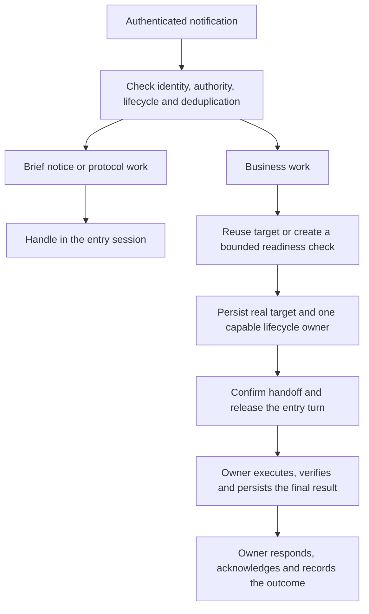

# Maintaining resident dispatcher sessions

Yobiru uses one fixed entry session to receive authenticated notifications. Keep that session
available for intake, then route business work to an appropriate session under the owner's existing
permissions. The policy lives in the [dispatcher template](../CODEX_DISPATCHER.md),
[inbox skill](../plugins/yobiru/skills/yobiru-inbox/SKILL.md) and
[wake skill](../plugins/yobiru/skills/yobiru-wake/SKILL.md).

## Why separate intake from business work

| Decision | Reason |
| --- | --- |
| Handle notices and brief protocol work in the entry session. | Small messages need no extra conversation or handoff. |
| Reuse the business session for the same matter. | Follow-ups retain decisions, permissions and artifacts without restarting work. |
| Create a separate session for an independent matter. | Unrelated work has its own context and can proceed within the host's concurrency limits. |
| Release the entry turn after a confirmed, durable handoff. | A long build, browser operation, generation or human wait should not hold up later messages. |
| Keep one lifecycle owner and persist the actual target. | After interruption, the next event can find the work and the party responsible for its result. |
| Use a stable resource key with an actual lock or lease. | Separate conversations must not write to the same repository, device, account or deployment concurrently. |

For example, a request to fix a project and a later message with an error log belong to the same
business session. A notice about another project can be handled without waiting for that fix.
A second request to write to the first project's repository must respect its existing resource owner.

## Handoff and result ownership



Before creating or delivering work, persist the message ID, unique dispatch marker, resource key,
project and authorization references in the installation's handled record under its existing lock.
A newly created session initially receives only a bounded readiness and permission check. Save its
real ID and verify its capabilities before delivering business work; never invent an ID to fill a gap.

Exactly one `lifecycle_owner` must be able to access the original inbox, handled records, request
ledger and CLI. If a remote worker cannot access them, a local business coordinator owns that
lifecycle and follows the remote work. Until handoff acceptance and the owner's ability to continue
are confirmed and persisted, responsibility stays with the entry session.

The entry session does not wait or poll for business completion after handoff. The owner reports
`running` only once work starts, verifies and persists its final result, then responds and acknowledges
the tracked request. Notification receipts need no reply. A handoff is not a final result and does
not permit early acknowledgment of a tracked request.

Unknown creation or delivery remains `dispatch_uncertain`; reconcile the marker and original target
before retrying. A timeout does not prove cancellation or failure. Do not restart overdue or terminal
requests, and do not rerun business work because a stored response is still waiting for delivery.
Preserve explicit data-home selection, existing reply permissions and owner-only inbox access.

## What the bridge does

The executable bridge maintains its notification queue and uses the configured Codex entry session.
The routing, resource ownership and lifecycle rules above are instructions for the host agent using
its available tools. A `resource_key` alone is not a lock. This documentation does not add an automatic
business scheduler, create sessions at plugin installation, or guarantee that a host can keep a child
running after the entry turn ends. Verify those capabilities before handoff; report a concrete blocker
when they are unavailable. See [bridge setup](../CODEX_LOCAL.md) and
[minimum sandbox access](CODEX_SANDBOX.md).

## Source files and maintenance

| File | Maintenance role |
| --- | --- |
| `CODEX_DISPATCHER.md` | Canonical template copied on a new bridge installation. |
| `plugins/yobiru/skills/yobiru-inbox/SKILL.md` | Canonical inbox processing and routing instructions. |
| `plugins/yobiru/skills/yobiru-wake/SKILL.md` | Canonical wake guidance pointing to the same routing policy. |
| `plugins/yobiru/scripts/codex_bridge/CODEX_DISPATCHER.md` | Generated, byte-identical template copy for the plugin package. |
| `plugins/yobiru/scripts/SOURCES.json` | Generated source mapping and SHA-256 hashes for bundled files. |

Make general policy changes in the canonical files and keep the skills and template consistent.
Then, from the repository root:

```sh
python3 tools/build_plugin.py sync
python3 tools/build_plugin.py check
python3 -m unittest discover -s tests -p test_build.py
git diff --check
```

Review and commit the source changes together with generated copies and hashes. Packaging checks
validate consistency and public-file hygiene; they do not prove a real host completed the handoff.
Keep host-specific paths, identities, authority and private message evidence out of the public policy.

The bridge installers preserve an existing local dispatcher file, including a configured custom
instructions path. They do not overwrite it with the latest template on upgrade. Back up the local
policy, compare it with the new template and merge applicable workflow changes under the installation's
existing authorization. Preserve the fixed session, home, routing exclusions and reply permissions.
Check that the host uses the configured instructions and supports continued business ownership before
claiming the workflow is active. An installed plugin-cache override is a local customization, not a
substitute for a source commit, a versioned release or a verified rollout to other machines.
